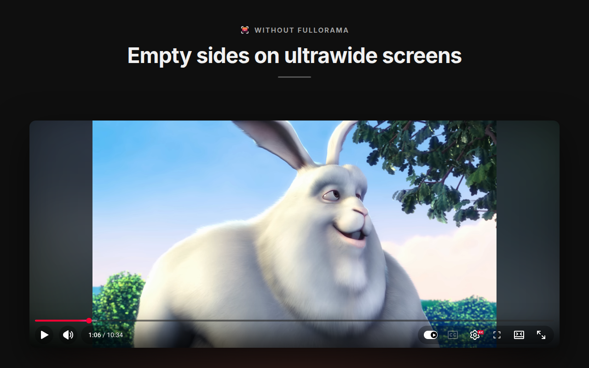
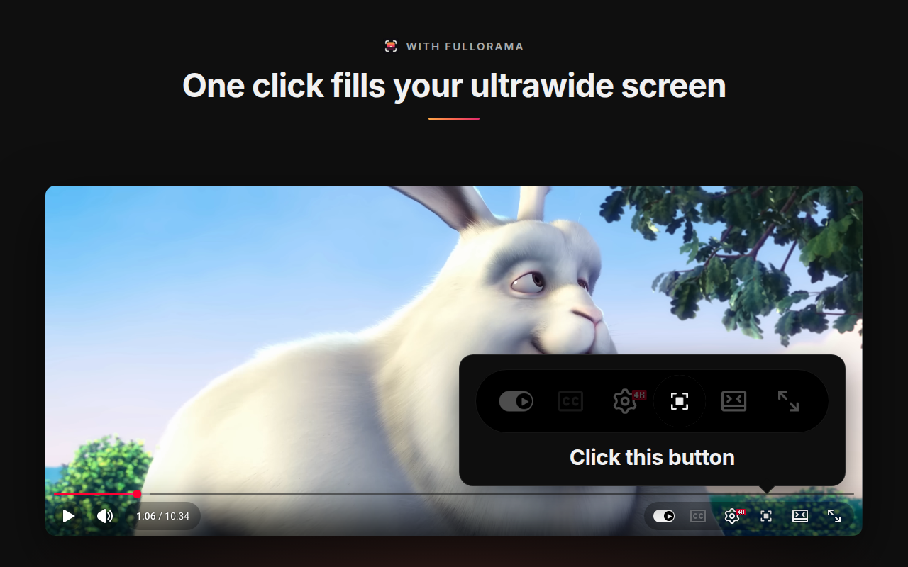

# Fullorama for YouTube™

Enjoy YouTube without distracting black bars on your ultrawide monitor.

Website: https://fullorama.com

[](https://chromewebstore.google.com/detail/fullorama-for-youtube/pacjdmdcmmnbpnjfhmjfgenbpedbakjg)
[](https://addons.mozilla.org/firefox/addon/fullorama/)

Fullorama for YouTube™ adds one button directly to YouTube's player. Choose Crop
or Stretch in the toolbar popup, then click the player button to turn that mode
on or off. Crop zooms in evenly to fill the player and trims the edges; stretch
widens the picture to fill it and leaves nothing out. The choice stays across
videos, refreshes, navigation, and fullscreen, until you change it.

Built for 21:9 and other ultrawide displays.

This project is not affiliated with YouTube, Google, or Alphabet.
YouTube is a trademark of Google LLC.

## Before and After

| Crop off | Crop on |
| --- | --- |
|  |  |

## Demo

https://github.com/user-attachments/assets/3c62393f-5d82-4c7b-8543-0c3c0938f052

[How the demo video was made](marketing/launch-film/making-of.md)

## Features

- Choose Crop or Stretch in the toolbar popup
- An Original frame and two result previews show what each mode does
- YouTube player button turns the selected mode on or off
- Crop mode zooms evenly to fill the player and trims the edges
- Stretch mode fills the player without trimming, at the cost of distortion
- The selected mode and on/off state persist across videos, refreshes, and navigation
- Works with YouTube's single-page navigation
- Works in theater mode and fullscreen
- Popup shows the selected mode and whether it's on or off
- Optional feedback form (popup link and uninstall survey)

## FAQ

### How do I watch YouTube full screen on an ultrawide monitor?

Install Fullorama for [Chrome](https://chromewebstore.google.com/detail/fullorama-for-youtube/pacjdmdcmmnbpnjfhmjfgenbpedbakjg) or [Firefox](https://addons.mozilla.org/firefox/addon/fullorama/) and play any YouTube video. Click Fullorama's icon in your browser toolbar and choose Crop or Stretch from the two result cards under the Original frame. Crop zooms the video in to fill the player; stretch fills it without trimming anything, at the cost of distortion. Then use the new button with four little corner brackets at the bottom-right of the player, next to the settings gear, to turn that mode on or off. A small square (crop) or wide bar (stretch) appears in the middle of the icon while it's on.

### I can't find the button. Where is it?

It's with YouTube's own buttons at the bottom-right of the video, between the settings gear and the theater-mode button. Move your mouse over the video if the controls are hidden. If the button isn't there, refresh the YouTube tab once. Tabs that were already open when you installed Fullorama don't get it until you do.

### Will the video look stretched?

Crop mode doesn't stretch anything. It zooms in evenly from the center, so people and objects keep their normal shape; the trade-off is that a little of the edges gets trimmed. Stretch mode does stretch the picture to fill the player and will make it look wider or taller than it is. Nothing gets trimmed in stretch mode. Use crop if you care more about shape, and stretch if you care more about seeing the whole frame. The player button turns the selected mode off at any time.

### Why do some videos still have black bars?

Some videos have the bars recorded into the picture itself, often old movies or re-uploads. Fullorama can't tell those apart from the real image, so they can stay even with a mode on. It also can't show picture that was never in the video.

### Does it work in theater mode and fullscreen?

Yes. When you switch to theater mode or fullscreen, the scaling adjusts automatically to fill the new size.

### Do I have to click it for every video?

No. Pick a mode once and it stays selected as you watch more videos, refresh, or browse around YouTube. It also remembers whether it was on or off. Change either from the toolbar popup or the player button whenever you like. The setting applies to all of YouTube in that browser.

### Does it work on 21:9 and 32:9 ultrawide monitors?

Yes. Fullorama works out the scaling from the shape of your player and the video, so it fits 21:9, 32:9 and anything in between. In crop mode, wider screens trim a little more of the edges; stretch mode fills them without trimming.

### Can I fill the screen and still see the whole picture?

Only if the video is already the same shape as your screen. Crop mode trims a little of the edges to fill it; stretch mode keeps everything but distorts the shape. You can turn the selected mode off any time to see the original picture.

### Does it work on Netflix, other sites, or my phone?

No, only YouTube in a desktop browser (Chrome or Firefox). It doesn't work on Netflix, Prime Video, other websites, or the YouTube app on phones and TVs.

### Will it slow YouTube down or make videos sharper?

It just scales the video that's already playing, so it doesn't change the video's quality or load anything extra. Scaling won't make it sharper, either. We haven't measured its effect on performance yet, but it does very little work. It only resizes the video you're watching.

### What's the toolbar icon for?

Clicking Fullorama's icon in your browser toolbar opens the mode picker. It shows whether the selected mode is on or off, alongside an Original frame and the two results: Crop keeps the shape and cuts off the edges; Stretch shows everything and pulls the video to fit. Clicking a card selects that mode and turns it on. To turn the selected mode off, use the button in the video player.

### Does Fullorama collect my data?

No. It saves two things in your browser: which mode you selected and whether it's on or off. It doesn't track what you watch, has no ads, and needs no account.

Feedback is optional and goes through a separate form run by Tally. It opens if you choose "Share feedback" in the toolbar popup, or after you uninstall. The form link includes the extension's version and where you opened it from. On Firefox, those two details are only sent if you've allowed the optional data permission. See the [privacy policy](https://fullorama.com/privacy) for the full details.

### Is it free?

Yes, completely free and open source. The code is on GitHub under the [MIT license](LICENSE).

## How It Works

The extension stores `fillMode` (`crop` or `stretch`) and `fillEnabled`
(`true` or `false`) in extension local storage (`chrome.storage.local` on Chrome
and `browser.storage.local` on Firefox). Two values are needed because the
player can be off while still remembering which mode its button will turn back
on. Upgrading translates the older keys on first load and removes them:
`cropMode: "crop"` or `"stretch"` becomes that mode with fill enabled,
`cropMode: "off"` becomes crop with fill disabled, and `cropEnabled: true` or
`false` becomes crop enabled or disabled.

The toolbar popup is interactive. It reads the state once, renders the status in
the header (`Crop is off`, `Crop is on`, `Stretch is off`, `Stretch is on`), and
outlines the selected card with a filled radio button. A static `Original`
preview sits above a branching connector; the two result cards show each mode
already applied. They are CSS-only: a 21:9 box holds a 16:9 still, scaled
uniformly by `21 ÷ 16 = 1.3125` for crop or on the X axis only for stretch.
Each selected card adds a short mirrored reflection under its preview. Clicking
a card calls `selectMode`, which selects that mode and turns fill on. The player
button calls `toggleEnabled`, so it only turns the selected mode off and on. A
tiny background script registers an uninstall survey URL so the browser can open
the optional feedback form if you remove the extension.

When enabled, the content script passes the on/off state and mode to the
renderer, which adds a class to YouTube's `#movie_player` element and sets CSS
variables from the current player and video aspect ratios. Crop scales both axes
by the same amount and clips the overflow, so the picture fills the player
without changing shape. Stretch scales only the shorter axis, so the picture
fills the player but changes shape. `content.css` applies both transforms from
the center.

YouTube rebuilds parts of its player during normal navigation, so the extension
uses YouTube navigation events, a controls-scoped `MutationObserver`, a
player-scoped `ResizeObserver`, video metadata events, window resize, fullscreen,
and short retry bursts to keep the button and mode state in sync. Player-size
changes automatically recalculate the scaling when entering or leaving theater
mode.

## Install Locally

You need [Bun](https://bun.sh) and Chrome, another Chromium browser, or Firefox.

```bash
bun install
bun run build
```

Then load it in Chrome:

1. Go to `chrome://extensions`
2. Turn on **Developer mode**
3. Click **Load unpacked**
4. Select the `dist-chrome/` folder
5. Open or refresh YouTube

Or load it temporarily in Firefox:

1. Go to `about:debugging#/runtime/this-firefox`
2. Click **Load Temporary Add-on...**
3. Select `dist-firefox/manifest.json`
4. Open or refresh YouTube

## Development

```bash
bun install
bun run dev
```

The dev command rebuilds the JavaScript on save. Reload the YouTube tab to test
changes.

Useful commands:

```bash
bun run typecheck
bun run test
bun run build
bun run lint:firefox
bun run pack:all
bun run release
```

`bun run release` validates the project (typecheck, build, tests, Firefox lint)
and creates Chrome, Firefox, and source ZIPs in `artifacts/`.

## Release

Releases are published from `main` via GitHub Releases.

1. Bump `version` in `package.json` (three-part numeric, e.g. `1.2.0`).
2. Commit and push to `main`.
3. Create a GitHub Release tagged `vX.Y.Z` with release notes.
4. The `publish` workflow builds the extension, attaches ZIPs to the release,
   submits Chrome through the Web Store V2 API, and submits Firefox through
   `web-ext sign`.

Chrome publishes automatically after review approval. Firefox receives a listed
update with source code and release notes. Store listing text and graphics are
maintained manually.

## License

MIT. See [LICENSE](LICENSE).
