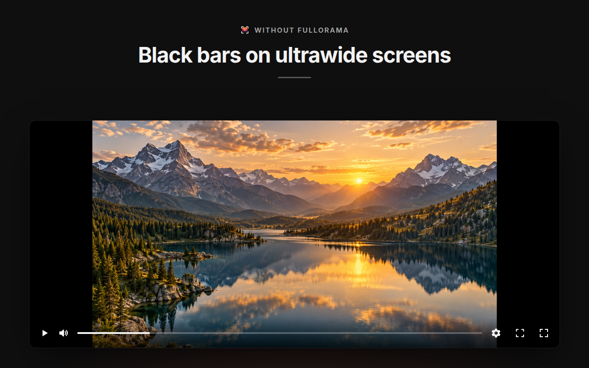
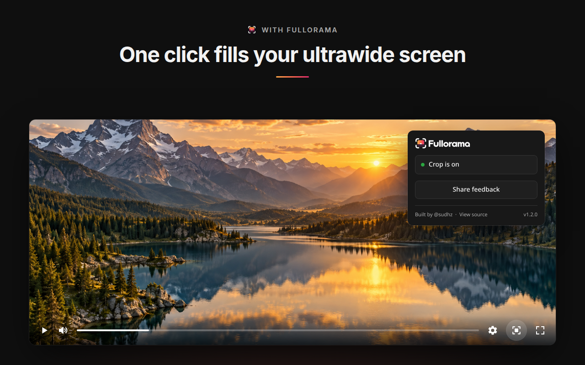

# Fullorama for YouTube™

Enjoy YouTube without distracting black bars on your ultrawide monitor.

[](https://chromewebstore.google.com/detail/fullorama-for-youtube/pacjdmdcmmnbpnjfhmjfgenbpedbakjg)
[](https://addons.mozilla.org/firefox/addon/fullorama/)

Fullorama for YouTube™ adds one crop button directly to YouTube's player. Turn
it on once and videos stay zoomed to fill across videos, refreshes, navigation,
and fullscreen, until you turn it off.

Built for 21:9 and other ultrawide displays.

This project is not affiliated with YouTube, Google, or Alphabet.
YouTube is a trademark of Google LLC.

## Before and After

| Crop off | Crop on |
| --- | --- |
|  |  |

## Demo

https://github.com/user-attachments/assets/3c62393f-5d82-4c7b-8543-0c3c0938f052

[How the demo video was made](marketing/launch-film/making-of.md)

## Features

- YouTube player button for ultrawide crop / zoom-to-fill
- Global persistent on/off state across videos, refreshes, and navigation
- Works with YouTube's single-page navigation
- Works in theater mode and fullscreen
- Read-only popup shows current crop status
- Optional feedback form (popup link and uninstall survey)

## FAQ

### How do I get rid of the black bars?

Install Fullorama for [Chrome](https://chromewebstore.google.com/detail/fullorama-for-youtube/pacjdmdcmmnbpnjfhmjfgenbpedbakjg) or [Firefox](https://addons.mozilla.org/firefox/addon/fullorama/) and play any YouTube video. Look at the bottom-right of the player: there's a new button with four little corner brackets, next to the settings gear. Click it and the video zooms in to fill the player. A small square appears in the middle of the icon to show it's on. Click it again to go back to normal.

### I can't find the button. Where is it?

It's with YouTube's own buttons at the bottom-right of the video, between the settings gear and the theater-mode button. Move your mouse over the video if the controls are hidden. If the button isn't there, refresh the YouTube tab once. Tabs that were already open when you installed Fullorama don't get it until you do.

### Will the video look stretched?

No. Fullorama zooms in evenly from the center, so people and objects keep their normal shape. The trade-off is that a little of the top and bottom gets trimmed. There's no stretch option.

### Why do some videos still have black bars?

Some videos have the bars recorded into the picture itself, often old movies or re-uploads. Fullorama can't tell those apart from the real image, so they can stay even with the button on. It also can't show picture that was never in the video.

### Does it work in theater mode and fullscreen?

Yes. When you switch to theater mode or fullscreen, the zoom adjusts automatically to fill the new size.

### Do I have to click it for every video?

No. Turn it on once and it stays on as you watch more videos, refresh, or browse around YouTube. Turn it off the same way whenever you like. The setting applies to all of YouTube in that browser.

### I have a 32:9 monitor. Will it work?

Yes. Fullorama works out the zoom from your player's shape, so it fits 21:9, 32:9 and anything in between. On very wide screens, more of the top and bottom gets trimmed, because the video has to zoom in further to fill the width.

### Can I fill the screen and still see the whole picture?

Not if the video and your screen are different shapes: filling the space without stretching always trims a bit off. If you'd rather see everything, turn the button off and keep the bars.

### Does it work on Netflix, other sites, or my phone?

No, only YouTube in a desktop browser (Chrome or Firefox). It doesn't work on Netflix, Prime Video, other websites, or the YouTube app on phones and TVs.

### Will it slow YouTube down or make videos sharper?

It just zooms in on the video that's already playing, so it doesn't change the video's quality or load anything extra. Zooming in won't make it sharper, either. We haven't measured its effect on performance yet, but it does very little work. It only resizes the video you're watching.

### What's the toolbar icon for?

Clicking Fullorama's icon in your browser toolbar shows whether the zoom is on or off, and has a link to send us feedback. To turn it on or off, use the button in the video player.

### Does Fullorama collect my data?

No. It saves one thing in your browser: whether the zoom is on or off. It doesn't track what you watch, has no ads, and needs no account.

Feedback is optional and goes through a separate form run by Tally. It opens if you choose "Share feedback" in the toolbar popup, or after you uninstall. The form link includes the extension's version and where you opened it from. On Firefox, those two details are only sent if you've allowed the optional data permission. See [PRIVACY.md](PRIVACY.md) for the full details.

### Is it free?

Yes, completely free and open source. The code is on GitHub under the [MIT license](LICENSE).

## Privacy and Permissions

Fullorama doesn't track what you watch, shows no ads and needs no account. See
[PRIVACY.md](PRIVACY.md) for the full privacy policy.

| Permission | Why                                        |
| ---------- | ------------------------------------------ |
| `storage`  | Stores whether ultrawide crop is on or off |

The content script is limited to `https://www.youtube.com/*`.

The popup's **Share feedback** link opens a Tally form, and the browser opens
the same form when you uninstall. The extension adds only a `source` label and
its `version` to the form URL. On Firefox, those values are included only when
the optional technical and interaction data permission is enabled.

## How It Works

The extension stores one boolean, `cropEnabled`, in extension local storage (`chrome.storage.local` on Chrome and `browser.storage.local` on Firefox).

A read-only toolbar popup displays whether crop is currently on or off by
reading the stored value once when opened. The popup cannot toggle crop — only
the player button can. A tiny background script registers an uninstall survey
URL so the browser can open the optional feedback form if you remove the
extension.

When crop is enabled, the content script adds a class to YouTube's
`#movie_player` element and sets a CSS scale variable based on the current
player aspect ratio and video aspect ratio. The CSS clips the player and scales
the rendered video from the center.

YouTube rebuilds parts of its player during normal navigation, so the extension
uses YouTube navigation events, a controls-scoped `MutationObserver`, a
player-scoped `ResizeObserver`, video metadata events, window resize, fullscreen,
and short retry bursts to keep the button and crop state in sync. Player-size
changes automatically recalculate the crop when entering or leaving theater mode.

## Install Locally

You need [Bun](https://bun.sh) and Chrome, another Chromium browser, or Firefox.

```bash
bun install
bun run build
```

Then load it in Chrome:

1. Go to `chrome://extensions`
2. Turn on **Developer mode**
3. Click **Load unpacked**
4. Select the `dist-chrome/` folder
5. Open or refresh YouTube

Or load it temporarily in Firefox:

1. Go to `about:debugging#/runtime/this-firefox`
2. Click **Load Temporary Add-on...**
3. Select `dist-firefox/manifest.json`
4. Open or refresh YouTube

## Development

```bash
bun install
bun run dev
```

The dev command rebuilds the JavaScript on save. Reload the YouTube tab to test
changes.

Useful commands:

```bash
bun run typecheck
bun run test
bun run build
bun run lint:firefox
bun run pack:all
bun run release
```

`bun run release` validates the project (typecheck, build, tests, Firefox lint)
and creates Chrome, Firefox, and source ZIPs in `artifacts/`.

## Release

Releases are published from `main` via GitHub Releases.

1. Bump `version` in `package.json` (three-part numeric, e.g. `1.2.0`).
2. Commit and push to `main`.
3. Create a GitHub Release tagged `vX.Y.Z` with release notes.
4. The `publish` workflow builds the extension, attaches ZIPs to the release,
   submits Chrome through the Web Store V2 API, and submits Firefox through
   `web-ext sign`.

Chrome publishes automatically after review approval. Firefox receives a listed
update with source code and release notes. Store listing text and graphics are
maintained manually.

## License

MIT. See [LICENSE](LICENSE).
