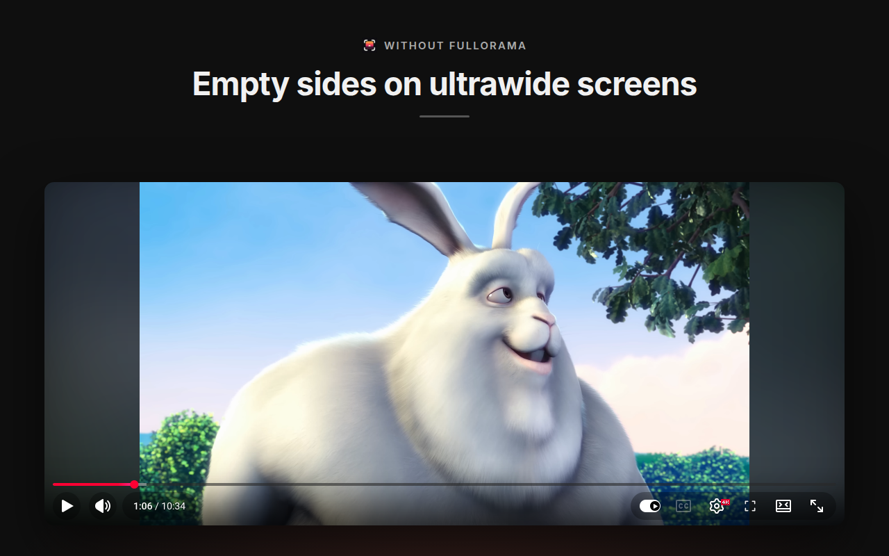
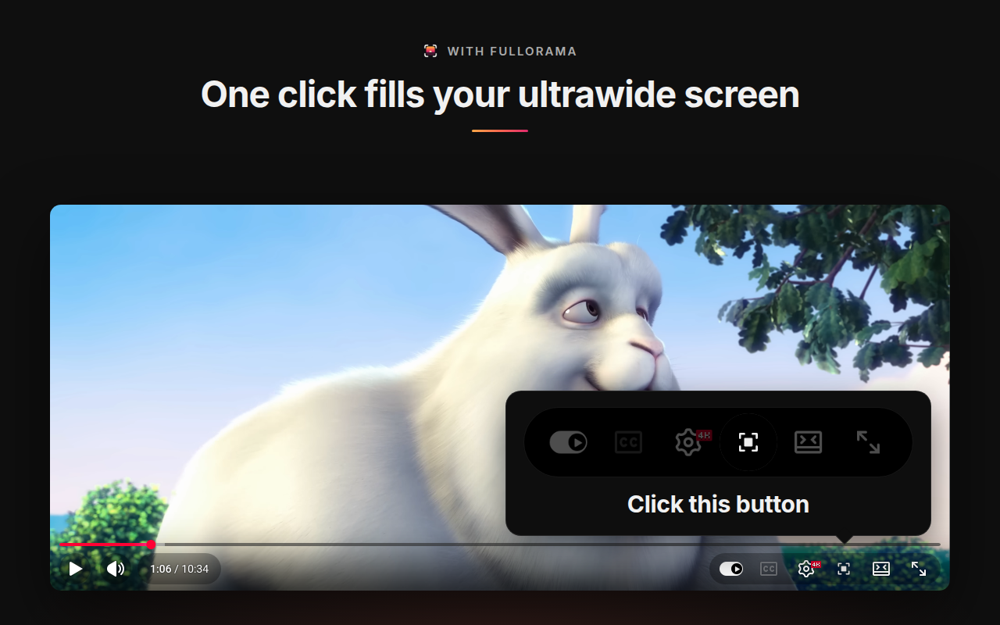

# Fullorama for YouTube™

Enjoy YouTube without distracting black bars on your ultrawide monitor.

Website: https://fullorama.com

[](https://chromewebstore.google.com/detail/fullorama-for-youtube/pacjdmdcmmnbpnjfhmjfgenbpedbakjg)
[](https://addons.mozilla.org/firefox/addon/fullorama/)

Fullorama for YouTube™ adds one button directly to YouTube's player. Turn it on
once and videos stay filled across videos, refreshes, navigation, and
fullscreen, until you turn it off. Choose Crop to zoom in and trim the edges, or
Stretch to pull the picture to fit.

Built for 21:9 and other ultrawide displays.

This project is not affiliated with YouTube, Google, or Alphabet.
YouTube is a trademark of Google LLC.

## Before and After

| Off | On |
| --- | --- |
|  |  |

## Demo

https://github.com/user-attachments/assets/3c62393f-5d82-4c7b-8543-0c3c0938f052

[How the demo video was made](marketing/launch-film/making-of.md)

## Features

- YouTube player button to fill your ultrawide screen with the video
- Toolbar popup to choose Crop or Stretch and turn it on or off
- Global persistent on/off state and mode across videos, refreshes, and navigation
- Works with YouTube's single-page navigation
- Works in theater mode and fullscreen
- Optional feedback form (popup link and uninstall survey)

## FAQ

### How do I watch YouTube full screen on an ultrawide monitor?

Install Fullorama for [Chrome](https://chromewebstore.google.com/detail/fullorama-for-youtube/pacjdmdcmmnbpnjfhmjfgenbpedbakjg) or [Firefox](https://addons.mozilla.org/firefox/addon/fullorama/) and play any YouTube video. Look at the bottom-right of the player: there's a new button with four little corner brackets, next to the settings gear. Click it and the video fills the player. A small square appears in the middle of the icon to show it's on. Click it again to go back to normal. To choose between Crop and Stretch, click Fullorama's icon in your browser toolbar.

### I can't find the button. Where is it?

It's with YouTube's own buttons at the bottom-right of the video, between the settings gear and the theater-mode button. Move your mouse over the video if the controls are hidden. If the button isn't there, refresh the YouTube tab once. Tabs that were already open when you installed Fullorama don't get it until you do.

### Will the video look stretched?

Not in Crop mode. It zooms in evenly from the center, so people and objects keep their normal shape. The trade-off is that a little of the edges gets trimmed. Stretch mode does pull the picture out of shape, but you see all of it. You can switch between them in the toolbar popup.

### Why do some videos still have black bars?

Some videos have the bars recorded into the picture itself, often old movies or re-uploads. Fullorama can't tell those apart from the real image, so they can stay even with the button on. It also can't show picture that was never in the video.

### Does it work in theater mode and fullscreen?

Yes. When you switch to theater mode or fullscreen, the video adjusts automatically to fill the new size.

### Do I have to click it for every video?

No. Turn it on once and it stays on as you watch more videos, refresh, or browse around YouTube. Turn it off the same way whenever you like. It remembers whether you chose Crop or Stretch, too. The setting applies to all of YouTube in that browser.

### Does it work on 21:9 and 32:9 ultrawide monitors?

Yes, and on any other screen size. Fullorama measures your player and the video, so it fills 21:9, 32:9, or any other shape. With Crop, a little more of the edges is trimmed on wider screens.

### Can I fill the screen and still see the whole picture?

Yes, with Stretch mode. It shows the whole picture, but pulls it out of shape. Crop mode keeps the shape and trims a little of the edges instead. You can turn the button off any time to see the original picture.

### Does it work on Netflix, other sites, or my phone?

No, only YouTube in a desktop browser (Chrome or Firefox). It doesn't work on Netflix, Prime Video, other websites, or the YouTube app on phones and TVs.

### Will it slow YouTube down or make videos sharper?

It just zooms or stretches the video that's already playing, so it doesn't change the video's quality or load anything extra. Zooming in won't make it sharper, either. We haven't measured its effect on performance yet, but it does very little work. It only resizes the video you're watching.

### What's the toolbar icon for?

Clicking Fullorama's icon in your browser toolbar lets you choose Crop or Stretch and turn it on or off. Choosing a mode turns it on, so you see it right away. The button in the video player turns it on or off too. There's also a link to send us feedback if you'd like.

### Does Fullorama collect my data?

No. It saves two things in your browser: whether it's on or off, and whether you chose Crop or Stretch. It doesn't track what you watch, has no ads, and needs no account.

Feedback is optional and goes through a separate form run by Tally. It opens if you choose "Share feedback" in the toolbar popup, or after you uninstall. The form link includes the extension's version and where you opened it from. On Firefox, those two details are only sent if you've allowed the optional data permission. See the [privacy policy](https://fullorama.com/privacy) for the full details.

### Is it free?

Yes, completely free and open source. The code is on GitHub under the [MIT license](LICENSE).

## Install Locally

You need [Bun](https://bun.sh) and Chrome, another Chromium browser, or Firefox.

```bash
bun install
bun run build
```

Then load it in Chrome:

1. Go to `chrome://extensions`
2. Turn on **Developer mode**
3. Click **Load unpacked**
4. Select the `dist-chrome/` folder
5. Open or refresh YouTube

Or load it temporarily in Firefox:

1. Go to `about:debugging#/runtime/this-firefox`
2. Click **Load Temporary Add-on...**
3. Select `dist-firefox/manifest.json`
4. Open or refresh YouTube

## Development

```bash
bun install
bun run dev
```

The dev command rebuilds the extension on save. Reload the YouTube tab, or
reopen the popup, to test changes.

Useful commands:

```bash
bun run typecheck
bun run test
bun run build
bun run lint:firefox
bun run pack:all
bun run release
```

`bun run release` validates the project (typecheck, build, tests, Firefox lint)
and creates Chrome, Firefox, and source ZIPs in `artifacts/`.

## Release

Releases are published from `main` via GitHub Releases.

1. Bump `version` in `package.json` (three-part numeric, e.g. `1.2.0`).
2. Commit and push to `main`.
3. Create a GitHub Release tagged `vX.Y.Z` with release notes.
4. The `publish` workflow builds the extension, attaches ZIPs to the release,
   submits Chrome through the Web Store V2 API, and submits Firefox through
   `web-ext sign`.

Chrome publishes automatically after review approval. Firefox receives a listed
update with source code and release notes. Store listing text and graphics are
maintained manually.

## License

MIT. See [LICENSE](LICENSE).
