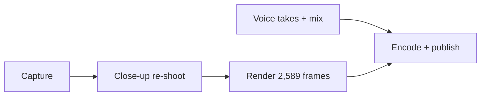

# Fullorama for YouTube™ — demo video

**Watch:** [YouTube](https://www.youtube.com/watch?v=hQ6AZAaAgBY) · [4K file on Release v1.2.0](https://github.com/sudhz/fullorama/releases/download/v1.2.0/fullorama-demo-4k.mp4) · inline in the [README](../../README.md#demo)

A 43.15 s, 3840×2160, 60 fps product film with a voiceover. Every product moment is real footage of the built extension on youtube.com, captured frame by frame in headless Chromium and composited in an HTML page that is rendered frame by frame.

These notes are the method, not the code: they hold the decisions, numbers and pitfalls, so the scripts can be rewritten quickly and the film edited without rediscovering anything.

| Document | What it covers |
|---|---|
| [timeline.md](timeline.md) | Every film time: browser actions, picture beats, voice lines, sound effects, music. Start every edit here. |
| [capture.md](capture.md) | Shooting YouTube frame by frame: browser setup, validation, recovery, the close-up re-shoot, YouTube's quirks. |
| [composition.md](composition.md) | The HTML page: camera, layers, brand pieces, desk plate, end card. |
| [voice.md](voice.md) | Carson voice takes, cutting and placing sentences, the mix. |
| [render.md](render.md) | Rendering, encoding, the checks, and publishing (release, README, YouTube). |

## Editing the film

The film is a function of one timeline. Change the numbers in [timeline.md](timeline.md), then redo only the stages the change touches:

| Change | Edit | Redo from | Time on this machine (3 cores, no GPU) |
|---|---|---|---|
| Text, colour or layout on the end card, labels, benefit lines | composition | Render | ~45 min |
| Move a picture beat (`PIC`) without moving a browser action | timeline | Render | ~45 min |
| Move or add a browser action (`ACT`), or change the footage | timeline | Capture | ~1 h 45 min (capture 15, close-up 15, render 35, encode 12) |
| Change or add a voice line | timeline (`VOICE`), and usually `PIC`/`ACT` around it | Voice, then whatever the timing change touches | +10 min, plus a few Cartesia credits |
| New feature beat (a new action, label and voice line) | all three timeline tables | Voice + Capture | ~2 h |
| Only re-encode or re-publish | — | Encode | ~15 min |

Rules that keep edits cheap:
- **Keep the capture** (`cap/`, about 1 GB) between edits. Beats that don't move a browser action never need a re-shoot.
- **A new beat makes the film longer:** extend `DURATION`, the soundtrack and every later time by the same amount. Moving later beats is a constant shift; nothing else depends on absolute times.
- **New voice lines need new takes for the whole read.** The takes behind the current soundtrack weren't kept, so the first voice change re-voices every line from a fresh Carson read. Keep the takes after that.
- **Verify before publishing,** with the checks in [render.md](render.md#checks). They have caught every real problem so far.

## History
- **v1.1.2 film** (YouTube Ultrawide Crop): the original.
- **v1.2.0 film:** rebuilt for the Fullorama name at 1080p, with a Gemini 3.8 Flash TTS voice (Puck) and *Caminandes 3*. Its process is in this file's git history.
- **Current film:** shot again from scratch at 4K, with the Cartesia "Carson" voice. The second video is *The Daily Dweebs*, since *Caminandes 3* only exists in 1080p. There is no on-screen caption, and nothing is painted over afterwards.

## Credits
- **Footage:** *Big Buck Bunny* © Blender Foundation (CC BY 3.0); *The Daily Dweebs* © Blender Studio (CC BY 4.0).
- **Music:** ende.app, "Happy Beats / Business Moves Vol. 11".
- **Sound effects:** Kenney (CC0).
- **Voice:** Cartesia Sonic 3.6 ("Carson").
- **Desk plate and thumbnail:** gpt-image-2; the desk plate is upscaled with Real-ESRGAN.
- **Icons:** Simple Icons (CC0).
- Fullorama is not affiliated with YouTube, Google or Alphabet. YouTube is a trademark of Google LLC.
