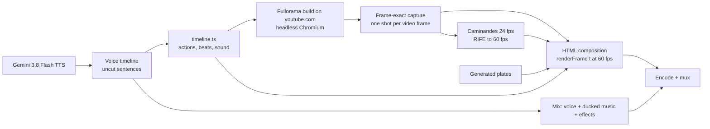

# Fullorama for YouTube™ — demo video: making of

`fullorama-demo.mp4`: 41.4 s, 1920×1080, 60 fps, H.264 + AAC, −15 LUFS. It is attached to GitHub Release v1.2.0 as an asset, not committed to the repo:

```bash
gh release upload v1.2.0 "fullorama-demo.mp4#Fullorama for YouTube — demo video (1080p60)"
```

It is a motion-designed product film with a voiceover. Every product moment in it is real footage of the built extension running on youtube.com, captured frame by frame. It was rebuilt from scratch for the Fullorama name and replaces the earlier YouTube Ultrawide Crop film.

## Idea

The film follows the MarketFast launch video recipe: pain first, the product fast, no feature lists.

- **Pain:** a gorgeous film on YouTube with two fat black bars in a 21:9 player.
- **Product:** one tiny button, one real click, and the video fills the screen.
- **Proof:** it stays on across new videos, refreshes, theater mode and fullscreen, shown as one continuous browsing session.
- **Punchline:** "Just YouTube, using the screen you paid for."



The voice comes first: `timeline.ts` places the voice sentence by sentence, and every real browser action, picture beat and sound effect is timed from it. The capture performs the actions at those film times, so the picture lines up with the voice without any retiming afterwards. The pacing follows the v1.1.2 film: each montage beat stays on screen for 2.3–2.5 s, long enough to read.

## Storyboard (film time)

| Time | Voiceover | Picture |
|---|---|---|
| 0.0–3.0 | "If you have an ultrawide monitor, you've seen this." | A floating dark browser rises onto the stage. YouTube theater mode, crop OFF, *Big Buck Bunny* with black side bars. |
| 3.0–6.8 | "A 21:9 display… playing YouTube like it's 16:9." | Slow push in. A "21:9 display" outline around the player, then a red "16:9 video" outline around the picture with hatched side bars. |
| 6.8–11.0 | (1.1 s pause) "So, I fixed it. Fullorama…" | The browser blurs and dims. Four corner brackets fly in and lock. On "Fullorama" the button's white "on" square appears between them and blooms into the sunset tile, and the wordmark rises. |
| 11.0–13.5 | "…adds one tiny button, directly to the YouTube player." | Tile and wordmark fold away; the brackets shrink and fly onto the real Fullorama button as the camera flies to a close-up of the player's bottom-right corner. |
| 13.5–14.9 | "Click it…" | The cursor glides onto the button. Real click at 14.75 s; the music drop lands on it, with a ring and a soft flash. The black bar disappears. |
| 14.9–18.6 | "…and the video instantly fills your ultrawide display. That's it." | Fast pull back to the whole browser: the video fills the 21:9 player. |
| 18.6–23.5 | "Turn it on once, and it stays on across NEW videos," | Montage framing and a "Crop stays on" pill. Label "New video" at 20.95; the cursor clicks YouTube's Next button on "videos" → real navigation (0.15 s) → *Caminandes 3* opens on the walking llama, still cropped. |
| 23.5–25.8 | "refreshes," | Label "Refresh". The cursor clicks the browser's reload button → real page reload (YouTube's loading page) → the video comes back where it was, still cropped. |
| 25.8–28.1 | "theater mode," | Label "Theater mode". Click to the default view, with YouTube's playlist and recommendations column, and back to theater; the crop re-fits each time. |
| 28.1–29.9 | "and fullscreen." | Label "Fullscreen". Real fullscreen click; the browser chrome peels away and the bare picture grows to fill the frame. |
| 29.9–33.5 | "No account. No tracking, nothing else to configure." | The same playback continues, blurred and dark, one line per phrase. |
| 33.5–36.5 | "Just YouTube, using the screen you paid for." | The picture sharpens and the camera pulls back: it is the screen of an ultrawide monitor on a desk. Caption. |
| 36.8–41.4 | "Fullorama. Free and open source." | End card: brackets land, the sunset tile pops in, the Fullorama wordmark, "Free and open source.", and Chrome Web Store · Firefox Add-ons · GitHub chips. |

## Visual identity
- **Colours:** stage near-black with a crimson floor bloom; UI greys from the popup (`#0f0f0f`, `#1c1c1e`, `#2c2c2e`, text `#f1f1f1`); the "16:9 video" outline `#ff4d6d`; the "on" dot `#2ba640`. The only gradient is the Fullorama icon's sunset tile (amber → coral → magenta over plum).
- **Player button:** the exact geometry from `src/player/button.ts`: a `0 0 36 36` viewBox, four stroked corner paths (`M8 13V8h5`, `M23 8h5v5`, `M28 23v5h-5`, `M13 28H8v-5`, stroke 2.5, round caps) and a white 10×10 centre square (`rx 1`) for the ON state. The brand moments are built from it, so the logo, the reveal and the real button share one shape.
- **Brand mark:** the same brackets around the sunset tile from `icons/128.png`, with the Fullorama wordmark from the logo lockup.
- **Type:** Inter Tight (labels, benefit lines) and Inter (UI, captions).
- **Browser frame:** 1500×838 px, radius 14, a 44 px dark title bar with traffic lights, back/forward/reload and the URL. The page inside is the captured 1680×889 viewport, scaled by 1500/1680.
- **Generated images** (gpt-image-2):
  - Stage: an empty near-black graphite backdrop with a soft crimson floor bloom and faint amber haze in the top corners (cropped to 16:9, dimmed 8 % in the composition).
  - Desk: a photoreal 34″ 21:9 monitor on a dark walnut desk at night, frontal, warm bias lighting, with a uniform chroma-green screen. The green is keyed out (`colorkey=0x00ff00:0.32:0.08,despill`) and the real fullscreen footage sits behind the bezel.
- **Finishing:** a vignette and animated grain (8 noise tiles, overlay blend at 5 %).

## 1. Capture real footage (`capture.ts`)
- **Browser:** the Fullorama build (`bun run build`, `dist-chrome`) plus uBlock Origin Lite (keeps ads out of shot) in headless Chromium 153 (`--headless=new --no-sandbox --autoplay-policy=no-user-gesture-required --mute-audio`), driven by `puppeteer-core`. Cookies `PREF=f6=400&hl=en&gl=US` (dark theme) and `wide=1` (theater mode). Injected CSS hides end screens, cards, tooltips, bezels, ambient mode and the watermark. YouTube's recommendations column stays, so theater mode shows the playlist panel under the player and the default view shows the playlist and suggestions, as on real YouTube. Two classes force the player controls hidden or shown.
- **Viewport:** 1680×889 at 2× density, so the theater player is exactly 21:9 (1680×720). After the fullscreen click it switches to 1680×642 at 1.25× (2.617:1).
- **Footage:** *Big Buck Bunny* in its 60 fps version (`aqz-KE-bpKQ`, AV1 1440p60) from 56 s, in an anonymous playlist (`watch_videos?video_ids=aqz-KE-bpKQ,L6mLFxGRFI4`) so the real Next button opens *Caminandes 3: Llamigos*.
- **Frame-exact slow motion:** playback runs at 0.0625× (Chrome's minimum). A `requestVideoFrameCallback` hook counts presented frames and records each frame's media time. The capture waits for the next presented frame, takes one JPEG screenshot (q90, ~170 ms), and checks that the frame counter did not change during the shot. At 0.0625× each 60 fps frame stays on screen for 0.27 s, so every frame is shot exactly once: no duplicates, no skips. Film time is the frame's media time minus the media time at the start of the phase.
- **Real actions at film times:** controls on/off, hover and click the Fullorama button, Next, the theater-mode button and the fullscreen button are performed for real (`page.mouse`) when the film time crosses their mark in `timeline.ts`, and each element's rectangle is logged so the drawn cursor and click rings land on it.
- **Navigation (Next):** happens in real time and is mapped to film time at 0.1× wall time, so the new page appears 0.15 s after the click. The phase ends as soon as *Caminandes 3* has loaded (title, duration and `readyState`), before its title shot plays; the player's own `seekTo` then starts it at 6.2 s, where the llama walks along the fence (the opening sky is nearly still and read as a frozen screen). The capture waits off-camera until playback runs, then the slow shoot continues.
- **Refresh:** a real `location.reload()`, mapped at 0.35× wall time. The old document is marked first, so the old page cannot count as loaded. When the new document's video has loaded, `seekTo` brings it back to where it was before the reload.
- **Modes:** `bun capture.ts` shoots everything (about 10 minutes); `bun capture.ts next` keeps the hero frames, seeks *Big Buck Bunny* to the hero's last media time and re-shoots from the Next click; `bun capture.ts reload` continues from the reload. Each writes `cap/f/*.jpg` and `cap/log.jsonl`; `manifest.ts` turns the log into `cap/manifest.json` (frames in film order plus action rectangles).

## 2. Caminandes to 60 fps (`interp.ts`, `rife.py`)
*Caminandes 3* is 24 fps content, so the capture holds one frame per content frame. Each continuous playback segment (before the reload, after it, and after the fullscreen switch) is interpolated to an exact 60 fps grid on its own, before any overlay exists, with **RIFE v4.25** ([Practical-RIFE](https://github.com/hzwer/Practical-RIFE), weights from the `MonsterMMORPG/Practical-RIFE` Hugging Face mirror) on CPU PyTorch:

- Each output time `start + k/60` sits between two captured frames; RIFE renders it at the matching timestep. Times within 2 % of a captured frame use that frame.
- Every output frame, captured or generated, goes through the same path at one size (1680 px wide for page segments, 2100 px for fullscreen), so sharpness does not pulse between real and generated frames.
- About 2 s per generated frame on 3 cores; the three segments take about 16 minutes.

ffmpeg's motion-compensated `minterpolate` was tried first: it warped the llama's legs and the fence posts and left a visible pulse every 0.2 s, which read as choppy.

Setup: a Python venv with CPU `torch`, `torchvision`, `opencv-python-headless` and `numpy`, plus the Practical-RIFE code with `flownet.pkl`, `IFNet_HDv3.py` and `RIFE_HDv3.py` in `train_log/`. On Nix, `LD_LIBRARY_PATH` needs `libstdc++` and `libz`.

## 3. Voiceover
Gemini 3.8 Flash TTS through the **Interactions API**, voice **Puck**. The transcript is spoken verbatim; delivery goes in `speech_metadata.style`, and pauses are inline tags. The response is 24 kHz mono WAV.

```bash
curl -s -X POST https://generativelanguage.googleapis.com/v1beta/interactions \
  -H "x-goog-api-key: $GEMINI_API_KEY" -H 'Content-Type: application/json' -d '{
  "model": "gemini-3.8-flash-tts",
  "input": [{"type":"user_input","content":[{"type":"text","text":"<TRANSCRIPT>",
    "annotations":[{"type":"speech_metadata","style":"<STYLE>"}]}]}],
  "response_format": {"type":"audio"},
  "generation_config": {"speech_config":[{"voice":"Puck"}]}}' \
| jq -r '[.steps[]|select(.type=="model_output")|.content[]|select(.type=="audio")]|last|.data' | base64 -d > take.wav
```

**Main take** (`main-q4`). Google's 3.8 guidance: start with an empty or short style, keep fixed traits such as age or persona out of it (long persona blocks are the main cause of voice drift), and shape delivery with punctuation, CAPITALS for stress and inline `<short pause>` / `<long pause>` tags. Style: `wry, conversational, speaking quickly`. Transcript:
```
If you have an ULTRAWIDE monitor, you've SEEN this. <short pause> A TWENTY-ONE by nine display... playing YouTube like it's SIXTEEN by nine. <long pause> So, I fixed it. <short pause> Fullorama adds one tiny button, directly to the YouTube player. <short pause> Click it... <long pause> and the video instantly fills your ultrawide display. <short pause> That's it. <long pause> No account. No tracking. Nothing else to configure. <short pause> Just YouTube, using the screen you paid for. <long pause> Fullorama. <short pause> Free and open source.
```
The stresses copy a prosody analysis of the v1.1.2 film's opening (about 5.4 syllables a second, wry, stress on "ultrawide" and "seen this"). An earlier main style that piled persona and enthusiasm cues onto the v1.1.2 style ("genuinely enthusiastic… a little grin…") came out about 2 semitones higher than the original and sounded like a different speaker, with a robotic opening.

**Montage take** (`montage-x2`): no style at all. Transcript: `<breath> Turn it on once, and it stays on across NEW videos, <long pause> refreshes, <long pause> theater mode, <long pause> and fullscreen.` "videos" rises to a high, open end, and the take's own pauses (1.2–1.4 s) give each item about 2 s.

**Picking takes** (v1.2.0 generated about 60 takes in all):
- **Opening:** 20 takes over four prompt variants (no style plus a throwaway "Okay, so." warm-up line; `wry, conversational, speaking quickly`; the warm-up line plus `wry, casual, friendly, speaking quickly`; the v1.1.2 style). Each opening was cut at its sentence edges, loudness-matched, and ranked against the original's opening in shuffled groups of four, over three rounds, so no clip gains from its position. The warm-up variants ranked last; `main-q4` ranked 1st, 1st and 2nd. The final choice was by ear from a page of the top five.
- **List intonation:** look at the last 0.4 s of each list item's pitch (40 ms autocorrelation tracker, 70–400 Hz). "videos" must end high and level or rising; a rise followed by a 2–3 semitone drop at the very end is heard as a full stop.
- **Words:** short clips make transcription guess ("That's it." came back as "I'm going to do my best."), so check words over clips of several seconds with word timings, then snap cuts to silences in the loudness envelope. `main-q4` repeats "That's it." after "configure."; that piece is left out at the sentence break. Check "Fullorama" (FULL-oh-RAH-ma) separately.
- Gemini reviews scored flat and lively takes alike and favour position in a pair, so they are only a check for words, pronunciation and obvious problems.
- **Free-tier limits:** `gemini-3.8-flash-tts` allows 10 requests a day and 3 a minute per project.

**Assembly** (`audio.ts`): pieces are whole sentences as spoken, never cut inside a sentence, placed at film times from `timeline.ts`. Cuts are 50 ms before and 100 ms after the speech, with 15 ms fades.

| Take | Source span (s) | Film onset (s) | Words |
|---|---|---|---|
| main | 0.00–6.39 | 0.40 | "If you have an ultrawide monitor… like it's sixteen by nine." |
| main | 7.04–7.88 | 7.90 | "So, I fixed it." |
| main | 8.28–11.79 | 9.25 | "Fullorama adds one tiny button, directly to the YouTube player." |
| main | 12.12–12.44 | 13.55 | "Click it…" |
| main | 13.35–15.61 | 14.90 | "and the video instantly fills your ultrawide display." |
| main | 16.19–16.69 | 17.75 | "That's it." |
| montage | 0.33–3.32 | 19.00 | "Turn it on once, and it stays on across NEW videos," |
| montage | 4.70–5.41 | 23.50 | "refreshes," |
| montage | 6.72–7.57 | 25.80 | "theater mode," |
| montage | 8.75–9.57 | 28.10 | "and fullscreen." |
| main | 17.24–20.12 | 29.95 | "No account. No tracking, nothing else to configure." |
| main | 21.52–23.37 | 33.75 | "Just YouTube, using the screen you paid for." |
| main | 24.20–26.20 | 36.85 | "Fullorama. Free and open source." |

The list items keep the take's own pauses, stretched by at most 0.3 s to match the original's beats. Lessons from earlier attempts: re-spacing phrases inside sentences sounds stitched and robotic, and long silences after a level or falling "videos" make it sound final. With a clearly rising "videos" and pauses close to natural, the list still sounds continuous.

## 4. Composition (`compose.html`, `timeline.ts`)
- **Page:** one 1920×1080 HTML page. `renderFrame(t)` builds every element as a pure function of film time `t`, then awaits image decoding. A `render` event (detail = time) drives it and `body[data-frame]` reports completion, so an automation script in another JavaScript context can step through frames.
- **Captured frames:** the frame shown at `t` is the latest captured frame at or before `t + 1/120`. Capture timestamps are rounded to the millisecond (17/17/16 ms steps), so "at or before `t`" picks the previous frame on every third grid point and shows one frame twice.
- **Camera:** the browser sits in a world layer; the camera maps a world point to a screen point at a zoom. Slow push 1.0 → 1.2 over the hook; fly to a 2.6× close-up on the Fullorama button at 11.05–11.80 s, framed low-right (1620, 760) because the button sits 121 px from the window's right edge; a slight drift to 2.68×; an exponential pull back to 1.0 after the click; montage framing at 0.86× with the browser lowered so the labels fit.
- **Brand reveal:** brackets fly in from four directions with a small rotation (7.80 s); the white "on" square pops (9.05 s) and blooms into the sunset tile (9.25–9.69 s, white fades off, corner radius grows to 22.5 %, soft glow); the wordmark rises with a blur-in (9.38 s). Before the flight the wordmark blurs out and the tile folds back into the square and vanishes; the brackets shrink to the real button's glyph size and land on it (11.80 s), then hand over to the captured button.
- **Cursor and clicks:** a drawn arrow cursor glides between the logged button rectangles with ease-in-out, presses on each click, and leaves a ring (a larger ring and a 16 % white flash on the crop click).
- **Montage labels:** a "Crop stays on" pill and one label per spoken item, each fading out before the next appears.
- **Fullscreen and desk:** from the first fullscreen frame the window holds its last windowed frame and dissolves (0.1 s) into the fullscreen picture, which starts on the theater player's place; the browser chrome peels away; the picture grows to cover the frame; blurred (22 px) and dimmed behind the benefit lines; then it becomes the desk monitor's screen as the keyed desk plate scales from 3.2× to 1.25×.
- **End card:** the v1.1.2 end-card layout with the brand pieces rebuilt: brackets land at 36.85 s, wordmark 36.92 s, tile 37.33 s, "Free and open source." 37.70 s, store chips from 38.10 s.

## 5. Sound and render
- **Music:** ende.app "Happy Beats / Business Moves Vol. 11", bundled with the [/brag skill](https://github.com/latent-spaces/brag). Start it 2.11 s into the track, so its drop lands on the click at 14.75 s; volume 0.42, 0.8 s fade in, 2.4 s fade out; side-chain ducked by the voice (`sidechaincompress threshold=0.035 ratio=5 attack=25 release=380`).
- **Voice:** highpass 70 Hz; compressor at threshold 0.12, ratio 2.5, makeup 1.6.
- **Effects:** Kenney CC0 clips, also bundled with /brag, each with `aecho 0.8:0.5:60:0.18`.

| Time (s) | Sound | Level |
|---|---|---|
| 7.75 | whoosh (pink noise 500–4200 Hz) | 0.10 |
| 11.78 | `interface/switch_002` | 0.22 |
| 14.73 | `ui/mouseclick1` | 0.55 |
| 14.80 | whoosh | 0.16 |
| 21.28, 23.68, 25.98, 26.78, 28.28 | `ui/mouseclick1` | 0.32 |
| 28.45 | whoosh | 0.08 |
| 33.60 | whoosh | 0.07 |
| 37.30 | `interface/select_008` | 0.20 |

- **Master:** mono mix duplicated to stereo, `alimiter limit=0.89`, then two-pass `loudnorm I=-15 TP=-1.2 LRA=9` (measure first, then apply with `linear=true`).
- **Frames:** `bun render.ts frames 0-2483 2` renders with its own headless Chromium, two pages in parallel, JPEG q95, retrying a frame on a fresh page if it hangs (about 11 minutes).
- **Encode:**

```bash
ffmpeg -framerate 60 -i frames/%05d.jpg -i soundtrack.wav -map 0:v -map 1:a \
  -c:v libx264 -preset slow -crf 16 -profile:v high -pix_fmt yuv420p \
  -c:a aac -b:a 192k -t 41.4 -movflags +faststart fullorama-demo.mp4
```

## Check
- **Smoothness:** measure `signalstats` YDIF (mean change from the previous frame) for every frame and count stalls: frames whose change is under 0.4× the median of their six neighbours while that median is above 0.35. This film has 21 in 1,339 moving frames, all single frames at real events (clicks, layout switches, the page change, cuts). Around the Next click, also check the longest run of near-still frames, and look for a 5-frame rhythm in the *Caminandes* stretch: after RIFE the five phases differ by about ±13 %, normal for 24 fps footage shown at 60.
- **Contact sheets** at 1 fps for the whole film and at 10 fps around the reveal and the end card.
- **Voice:** pitch and energy measurements above, plus a Gemini review of the full film for splices, pauses, list intonation and sync. Verify any timing it reports against the audio before acting on it.

## Store listings (manual)
- **Chrome Web Store:** the listing video must be a YouTube link, set in Developer Dashboard → Store listing. The v2 API only handles upload, publish and status. Upload the MP4 to YouTube first.
- **Firefox Add-ons:** listing previews are PNG/JPEG only. Use a still from the film as the first preview and link the video in the description.

**Share copy:** Bought a 21:9 monitor, still watching YouTube with two fat black bars? Fullorama adds one tiny button to the player: click it once and every video fills the screen you paid for, across new videos, refreshes, theater mode and fullscreen. Free and open source for Chrome and Firefox.

## Credits
- **Footage:** *Big Buck Bunny* and *Caminandes 3: Llamigos* © Blender Foundation, CC BY.
- **Music:** ende.app, "Happy Beats / Business Moves Vol. 11".
- **Sound effects:** Kenney (CC0).
- **Voice:** Gemini 3.8 Flash TTS.
- **Generated plates:** gpt-image-2.
- Fullorama is not affiliated with YouTube, Google or Alphabet. YouTube is a trademark of Google LLC.
