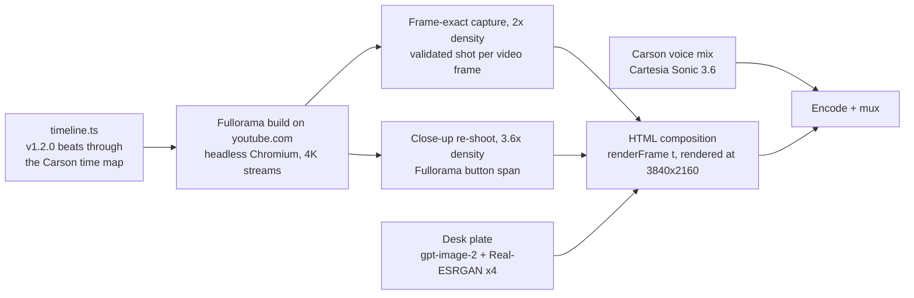

# Fullorama for YouTube™ — demo video: making of

`fullorama-demo-4k.mp4`: 43.15 s, 3840×2160, 60 fps, H.264 (CRF 14) + AAC, 165 MB. It is attached to GitHub Release v1.2.0 as an asset, not committed to the repo. A 1080p60 version (CRF 17, 24 MB) made from the same frames plays inline in the README, as a GitHub attachment.

```bash
gh release upload v1.2.0 "fullorama-demo-4k.mp4#Fullorama for YouTube — demo video (4K60)"
```

It is a motion-designed product film with a voiceover. Every product moment in it is real footage of the built extension running on youtube.com, captured frame by frame. It replaces the v1.2.0 film (1080p, Gemini voice, *Caminandes 3*): this one is shot again from scratch at 4K, with the Carson voice and a 4K second film.

## Idea

The film follows the MarketFast launch video recipe: pain first, the product fast, no feature lists.

- **Pain:** a gorgeous film on YouTube with two fat black bars in a 21:9 player.
- **Product:** one tiny button, one real click, and the video fills the screen.
- **Proof:** it stays on across new videos, refreshes, theater mode and fullscreen, shown as one continuous browsing session.
- **Punchline:** "Just YouTube, using the screen you paid for." (spoken; there is no on-screen caption)



## Timing

The picture keeps the v1.2.0 beats. The Carson read is slower, so five still moments were lengthened by 1.75 s in total, and `timeline.ts` maps every v1.2.0 time through that map (`toFilm`): inside a lengthened span time stretches linearly, after it everything shifts by its extra. The capture performs the real browser actions at the mapped times, so picture and voice line up without retiming afterwards.

| v1.2.0 span (s) | Extra (s) |
|---|---|
| 8.40–9.00 | 0.400 |
| 9.85–10.70 | 0.367 |
| 30.38–30.83 | 0.300 |
| 31.28–31.53 | 0.283 |
| 37.63–37.69 | 0.400 |

## Storyboard (film time)

| Time | Voiceover | Picture |
|---|---|---|
| 0.0–3.0 | "If you have an ultrawide monitor, you've seen this." | A floating dark browser rises onto the stage. YouTube theater mode, crop OFF, *Big Buck Bunny* with black side bars. |
| 3.0–6.8 | "A 21:9 display… playing YouTube like it's 16:9." | Slow push in. A "21:9 display" outline around the player, then a red "16:9 video" outline around the picture with hatched side bars. |
| 6.8–11.8 | "So, I fixed it. Fullorama…" | The browser blurs and dims. Four corner brackets fly in and lock. On "Fullorama" the button's white "on" square appears between them and blooms into the sunset tile, and the wordmark rises. |
| 11.8–14.3 | "…adds one tiny button, directly to the YouTube player." | Tile and wordmark fold away; the brackets shrink and fly onto the real Fullorama button as the camera flies to a close-up of the player's bottom-right corner. |
| 14.3–15.7 | "Click it…" | The cursor glides onto the button. Real click at 15.52 s; the music drop lands on it, with a ring and a soft flash. The black bars disappear. |
| 15.7–19.4 | "…and the video instantly fills your ultrawide display. That's it." | Fast pull back to the whole browser: the video fills the 21:9 player. |
| 19.4–24.3 | "Turn it on once, and it stays on across new videos," | Montage framing and a "Crop stays on" pill. Label "New video"; the cursor clicks YouTube's Next button → real navigation → *The Daily Dweebs* opens on the small chicken and the dog, still cropped. |
| 24.3–26.6 | "refreshes," | Label "Refresh". The cursor clicks the browser's reload button → real page reload (YouTube's loading page) → the video comes back where it was, still cropped. |
| 26.6–28.9 | "theater mode," | Label "Theater mode". Click to the default view, with YouTube's playlist and recommendations column, and back to theater; the crop re-fits each time. |
| 28.9–30.7 | "and fullscreen." | Label "Fullscreen". Real fullscreen click; the browser chrome peels away and the bare picture grows to fill the frame. |
| 30.7–34.9 | "No account. No tracking, nothing else to configure." | The same playback continues, blurred and dark, one line per phrase. |
| 34.9–37.9 | "Just YouTube, using the screen you paid for." | The picture sharpens and the camera pulls back: it is the screen of an ultrawide monitor on a desk. |
| 38.2–43.15 | "Fullorama. Free and open source." | End card: brackets land, the sunset tile pops in, the Fullorama wordmark, "Free and open source.", and Chrome Web Store · Firefox Add-ons · GitHub chips. |

## Visual identity
- **Colours:** stage near-black with a crimson floor bloom; UI greys from the popup (`#0f0f0f`, `#1c1c1e`, `#2c2c2e`, text `#f1f1f1`); the "16:9 video" outline `#ff4d6d`; the "on" dot `#2ba640`. The only gradient is the Fullorama icon's sunset tile (amber → coral → magenta over plum).
- **Player button:** the exact geometry from `src/player/button.ts`: a `0 0 36 36` viewBox, four stroked corner paths (`M8 13V8h5`, `M23 8h5v5`, `M28 23v5h-5`, `M13 28H8v-5`, stroke 2.5, round caps) and a white 10×10 centre square (`rx 1`) for the ON state. The brand moments are built from it, so the logo, the reveal and the real button share one shape.
- **Vector brand pieces** (sharp at any size): the sunset tile is an SVG with colours sampled from `icons/128.png` (sky `#fdaf47` → `#da2172`, half sun `#fdf4c5`, ground `#421830`); the wordmark is live text in Outfit 800, spaced to the logo lockup's proportions; "Free and open source." is Inter 500; the store chips are HTML pills with Simple Icons logos (Chrome, Firefox, GitHub).
- **Backgrounds:** the stage and the end card are CSS gradients fitted to the v1.2.0 plates (sampled on a grid, mean error about 4–6 levels), so they render natively at 4K.
- **Type:** Inter Tight (labels, benefit lines), Inter (UI, chips), Outfit (wordmark).
- **Browser frame:** 1500×838 px, radius 14, a 44 px dark title bar with traffic lights, back/forward/reload and the URL. The page inside is the captured 1680×889 viewport, scaled by 1500/1680.
- **Desk plate:** gpt-image-2 (photoreal 34″ 21:9 monitor on a dark walnut desk at night, frontal, warm bias light, uniform chroma-green screen, nothing in the foreground), upscaled 4× to 6144×4096 with Real-ESRGAN x4plus (tiled, CPU). The screen is not keyed: its four edges are fitted on the plate with sub-pixel precision and cut out as an exact anti-aliased rectangle, with green spill on the bezel neutralised. The real fullscreen footage sits behind it.
- **Finishing:** a vignette and animated grain (8 noise tiles, 1024 px, overlay blend at 5 %).

## 1. Capture real footage (`capture.ts`)
- **Browser:** the Fullorama build (`bun run build`, `dist-chrome`) plus uBlock Origin Lite (keeps ads out of shot) in headless Chromium 153, driven by `puppeteer-core`. Cookies `PREF=f6=400&hl=en&gl=US` (dark theme) and `wide=1` (theater mode). Injected CSS hides end screens, cards, tooltips, bezels, ambient mode and the watermark. The recommendations column stays, as on real YouTube.
- **Viewport:** 1680×889 at 2× density (3360 px wide), so the theater player is exactly 21:9 (1680×720). After the fullscreen click it switches to 1680×642, still at 2×: a player wider than the 3840 px stream makes YouTube switch *The Daily Dweebs* to its 8K stream, which stalls playback.
- **Footage:** *Big Buck Bunny* 60 fps at 2160p (`aqz-KE-bpKQ`) from 56 s, in an anonymous playlist (`watch_videos?video_ids=aqz-KE-bpKQ,RJnKaAtBPhA`) so the real Next button opens *The Daily Dweebs* (Blender Studio, mastered in 8K, streamed at 2160p). It starts at 13.5 s: the camera is locked off from 11.3 to 36 s (measured with phase correlation on the sky and roofline), while before and after that the giant chicken's stomps shake it. Most Blender open movies on YouTube (*Spring*, *Coffee Run*, *Sprite Fright*, *Agent 327*) stop at 2048 px, and *Caminandes 3* at 1080p.
- **Native frame rate:** *The Daily Dweebs* is 24 fps and stays that way: each frame is held for 2–3 film frames, as on a real 60 Hz screen. Everything else in the film runs at 60 fps.
- **Mouse rest:** while not acting, the pointer rests in empty space right of the video title, so no YouTube button shows a hover tooltip (v1.2.0 rested on "Share").
- **Frame-exact slow motion:** playback runs at 0.0625×. A `requestVideoFrameCallback` hook counts presented frames and records each frame's media time. Exactly one shot is kept per media frame on the content's grid (60 or 24 fps). A shot is kept only if the frame counter did not change during it, no YouTube error screen is showing and the video is ready; a missed frame (a gap in media time) or a discarded shot is re-shot by seeking back 0.5 s. Film time comes from media time, so nothing shifts.
- **Recovery:** at 1/16 speed the 24 fps stream goes a long time between segment fetches and YouTube's player can fail ("Something went wrong"). The capture then reloads off-camera, restores theater mode and fullscreen (same hover and click as the real one), seeks back and continues; frames already shot are skipped. After the scripted refresh, YouTube can come back in the default view; theater mode is restored off-camera too.
- **Real actions at film times:** controls on/off, hover and click the Fullorama button, Next, the theater-mode button and the fullscreen button are performed for real (`page.mouse`) when the film time crosses their mark, and each element's rectangle is logged so the drawn cursor and click rings land on it.
- **Navigation and refresh:** both happen in wall time, mapped to film time at 0.1× (Next) and 0.35× (reload). The old document is marked before the reload, so it cannot count as loaded; `seekTo` then brings the video back where it was.
- **Close-up re-shoot** (`bun capture.ts closeup`): the span where the camera is fully zoomed onto the Fullorama button (about 2.6×) is shot again at 3.6× density, clipped to the region the camera shows (`closeup-clip.ts` computes it from the composition's own camera). It uses real slow playback like the main capture, so YouTube's hover pill and the click behave as they did, over several passes until every frame is covered. 3.6× keeps each shot (about 6 MP) inside the 267 ms a frame stays on screen; 4× and above lost most shots. The same browser profile is reused, because a fresh profile is a new visitor and can get a different page layout. Pausing and stepping frame by frame was tried first: paused, YouTube's idle timer hides the hover pill.
- **Page under the player** (`bun capture.ts strip`): YouTube reorders its Share/Download/Save buttons during a session, so the static page area under the player in the close-up frames comes from one high-density still with the main capture's order, checked against it before it is pasted (`pastestrip.py`).
- **Checks:** `checkcap.py` (media-time continuity per phase, film time monotonic, no error screens or blank frames) and `checkclose.py` (every close-up frame against the main frame of the same time).

## 2. Voiceover and mix
- **Voice:** Cartesia Sonic 3.6, voice **Carson** (`86e30c1d-714b-4074-a1f2-1cb6b552fb49`). Sentences are cut at quiet points next to the words, never inside a sentence, and placed on the picture beats through the time map.
- **Levels:** voice at −18 LUFS; music set so the voice sits about 17 dB above it while speaking, ducked by the voice.
- **Music:** ende.app "Happy Beats / Business Moves Vol. 11", bundled with the [/brag skill](https://github.com/latent-spaces/brag), offset so its drop lands on the click at 15.52 s.
- **Effects:** Kenney CC0 clips (whooshes, clicks, a switch and a select), at the v1.2.0 times mapped through the time map.
- The soundtrack (`carson.m4a`, AAC 48 kHz stereo, 43.15 s) is muxed as is.

v1.2.0 used Gemini 3.8 Flash TTS (voice Puck); that process is in the git history of this file.

## 3. Composition (`compose.html`, `timeline.ts`)
- **Page:** one 1920×1080 HTML page rendered at device scale 2 (3840×2160). `renderFrame(t)` builds every element as a pure function of film time `t`, then awaits image decoding. A `render` event (detail = time) drives it and `body[data-frame]` reports completion.
- **Captured frames:** the frame shown at `t` is the latest captured frame at or before `t + 1/120`.
- **Close-up:** from 0.15 s before the camera lands on the button, the 3.6× frame of the same time is laid over the region it covers, crossfading in over 0.15 s. It hands back to the main capture in the first 22 ms of the pull-back: right after the click YouTube hides the hover pill in the main capture for 11 frames, while it stays on in the close-up, and both show it again from the pull-back.
- **Camera:** the browser sits in a world layer; the camera maps a world point to a screen point at a zoom. Slow push 1.0 → 1.2 over the hook; fly to a 2.6× close-up on the Fullorama button, framed low-right because the button sits near the window's right edge; a slight drift to 2.68×; an exponential pull back to 1.0 after the click; montage framing at 0.86×.
- **Brand reveal:** brackets fly in from four directions with a small rotation; the white "on" square pops and blooms into the sunset tile; the wordmark rises with a blur-in. Before the flight the wordmark blurs out and the tile folds back into the square; the brackets shrink to the real button's glyph size and land on it, then hand over to the captured button.
- **Cursor and clicks:** a drawn arrow cursor glides between the logged button rectangles with ease-in-out, presses on each click, and leaves a ring (a larger ring and a 16 % white flash on the crop click).
- **Fullscreen and desk:** from the first fullscreen frame the window holds its last windowed frame and dissolves (0.1 s) into the fullscreen picture; the browser chrome peels away; the picture grows to cover the frame, blurred (22 px) and dimmed behind the benefit lines; then it becomes the desk monitor's screen as the desk plate pulls back. In the final desk shot the plate is placed so the screen is 1231 px wide (of 1920).
- **End card:** brackets land, wordmark, tile, "Free and open source.", store chips; the same layout as v1.2.0, built from live text and vectors.

## 4. Render and encode
- **Frames:** `bun render.ts ../frames 0-2588 1` renders 2,589 frames at 3840×2160 with its own headless Chromium, JPEG q96, resumable (about 33 minutes on 3 cores).
- **Encode:**

```bash
ffmpeg -framerate 60 -i frames/%05d.jpg -i carson.m4a -map 0:v -map 1:a \
  -c:v libx264 -preset slow -crf 14 -profile:v high -level 5.2 -pix_fmt yuv420p \
  -x264-params keyint=120:min-keyint=60 -color_primaries bt709 -color_trc bt709 -colorspace bt709 \
  -c:a copy -t 43.15 -movflags +faststart fullorama-demo-4k.mp4
```

The 1080p version adds `-vf scale=1920:1080:flags=lanczos` with CRF 17 and level 4.2. `rebuild.sh` runs the whole chain (capture, checks, close-up, strip, render, motion check, both encodes) and stops at the first failed step.

## Check
- **Capture:** no gaps, repeats or error screens in any phase (`checkcap.py`); the close-up matches the main capture frame for frame before the click (`checkclose.py`).
- **Motion:** `motion.py` measures the change from the previous frame for every rendered frame. Repeated frames inside motion occur only in the 24 fps stretch (its normal 2-3 cadence); every isolated jump is a real event (the click, Next, the refresh, theater mode, fullscreen) or a scene cut in *Big Buck Bunny*. It also tracks sharpness across the close-up crossfades.
- **Encode:** PSNR of the 4K file against the rendered frames: mean 51.6 dB, worst frame 46.6 dB (the desk pull-back with grain).
- **By eye:** contact sheets of the whole film every 0.5 s, and full-resolution crops of every transition (close-up in and out, Next, refresh, fullscreen, desk, end card).

## Store listings (manual)
- **Chrome Web Store:** the listing video must be a YouTube link, set in Developer Dashboard → Store listing. The v2 API only handles upload, publish and status. Upload the 4K MP4 to YouTube first.
- **Firefox Add-ons:** listing previews are PNG/JPEG only. Use a still from the film as the first preview and link the video in the description.
- **YouTube thumbnail:** "FIXED" (1280×720, gpt-image-2): before and after ultrawide monitors showing a generic mountain landscape, black bars and a red X on top, filled with a green check below.

**Share copy:** Bought a 21:9 monitor, still watching YouTube with two fat black bars? Fullorama adds one tiny button to the player: click it once and every video fills the screen you paid for, across new videos, refreshes, theater mode and fullscreen. Free and open source for Chrome and Firefox.

## Credits
- **Footage:** *Big Buck Bunny* © Blender Foundation (CC BY 3.0); *The Daily Dweebs* © Blender Studio (CC BY 4.0).
- **Music:** ende.app, "Happy Beats / Business Moves Vol. 11".
- **Sound effects:** Kenney (CC0).
- **Voice:** Cartesia Sonic 3.6 (Carson).
- **Generated desk plate:** gpt-image-2, upscaled with Real-ESRGAN.
- **Icons:** Simple Icons (CC0).
- Fullorama is not affiliated with YouTube, Google or Alphabet. YouTube is a trademark of Google LLC.
